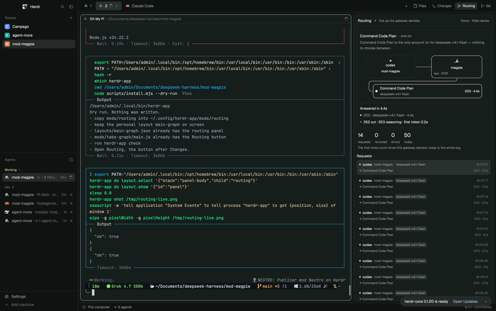

# Magpie routing

A side panel, beside Files and Changes, that shows [Magpie](https://github.com/yetone/magpie) routing inside Herdr. One stage: the agent, Magpie, and the accounts it weighed. Every request in flight is its own bird, in its agent's color, so several agents can be watched at once.

The panel does not dock by itself. `npx github:Izzy2024/magpie-mod` copies it and adds the Routing button. Copying the folder alone leaves it hidden. An agent adding this mod from the gallery should run that (or `node scripts/install.mjs`) rather than stop after the copy.

## What you see

- **The Routing button**, at the right end of the tab bar, immediately after Changes (and before any other button already there, such as Git). A 26px pill, the same shape as Files and Changes: a 14px route icon and "Routing", `selected` while its panel shows, `chrome` otherwise.
- **The panel**, the next child of the side-panel stack (368px by default), as a card: 10px radius, 1px `border`, `background`, 13px type.
  - A 42px header, 14px side padding, bottom border. "Routing" semibold. A 6px dot, `ansi2` and breathing while something is in flight, `dim` when nothing is. Then 11px `muted` status: "live, as the gateway decides", "N in flight", "demo", or "offline". On the right, two 11px text buttons: "Demo" / "Stop demo", and "Hide names" / "Show names".
  - **In flight**, only when two or more requests are in flight (or one is pinned while others fly): an 11px semibold `muted` heading "In flight · N", then one row per request. A 6px dot in the agent's color, the agent and its Herdr space at 12px, what it is waiting on at 11px `muted`, and a live clock.
  - **The stage.** The agent card and the Magpie card are 78px tall, 12px radius, 1px border. Magpie's card has a `shadow` and a `foreground` border; its title is "magpie". Account rows are 50px, 10px radius. A row shows the account name, the model at 11px `muted`, and how many requests are on it, in their agents' colors. A failing account is `ansi1` and its row says the status. A row not on this request is at 55% opacity. Wires are orthogonal with 8px rounded corners: down from Magpie to a horizontal bus, left to a lane beside the accounts, then down and into each account.
  - **Under the stage:** the outcome in 12px semibold, then one line per step of the request. Four counts in 18px: requests, rerouted, errors, today. The caption under them: "The first three count since this gateway started; today is the whole log."
  - **Requests.** A 12px semibold heading, and "Back to live" in `accent` while an old request is pinned. Each row is the agent, its space, what it asked, where it went, and when. The pinned row is `selected`. "No request yet today." when the log is empty.
- **Empty**, when Magpie is not running and there is no log: "Waiting for a request" and "Magpie isn't running, so nothing is routed." With a log but no gateway: "The gateway didn't answer. It retries." plus "Showing the last requests; checking again every few seconds."

## How it behaves

- **Demo** (the header button, or `d` after clicking the panel) plays a scripted afternoon: three agents (cindy, atlas, nova), five requests, one of them failing over twice (429, then 503, then a third account). "Stop demo" returns to the gateway. Nothing is sent.
- **Hide names** (or `m`) masks account names. "Show names" puts them back.
- Click a request in the log, or a row in the in-flight strip, to replay its journey. "Back to live" (or `Esc`) follows the newest again. `↑`/`↓` or `j`/`k` move through the log. `r` replays the one that is showing.
- Click the agent card, when it matched a terminal, to focus that terminal (`pane.focus`). The tooltip is "Go to its terminal". Magpie records the folder as a short label (`deepseek-harness/mod-magpie`). That is matched to a terminal's folder. When several terminals share the folder, the one that is working wins, then blocked, then done, then idle.
- While the panel is the shown side panel, it long-polls the gateway. Hidden, it polls without waiting. A request in flight is drawn at about 60fps (a 16ms timer): the bird banks at most ±24°, its wings beat every 420ms, and it flies 620ms from the agent to Magpie, 900ms or 1400ms onward. The bird lets go; the dot stays and pulses on the account until that try finishes. A failure flies back to Magpie and out to the next account. A second bird brings the answer back. The cards redraw when what they show changes, and four times a second for the clocks. A hold on an account does not run a JS frame: the wire stays lit and the dot pulses.
- The in-flight clocks and the log tick five times a second, and only while the panel is showing and something is unfinished.
- **Adding it.** From a clone of this repo, `node scripts/install.mjs` (or `npx github:Izzy2024/magpie-mod` anywhere). `--dry-run` prints the plan. `--uninstall` removes the mod, the panel child and the button, and leaves any cloned layout or tab bar in place.
  - If the window is on Herdr's own `main`, the script clones it to `main-routing`, clones `tabs` to `tabs-routing`, points the clone's tab bar at `tabs-routing`, and switches to `main-routing`. `ctrl-shift-l` goes back to `main`. Herdr replaces `layouts/main.json` and `mods/tabs` on every start, so the button cannot live there.
  - If the window is already a personal layout with a `panel-body` stack (a clone, `cloned_from` set), the script edits that layout and its tab-bar mod and does not switch away. It does not clone `tabs` when the layout already uses a personal tab bar.
  - The layout edit appends `{ "id": "routing", "type": "block", "content": { "mod": "routing" } }` to `panel-body`, before a `graph` child when there is one.
  - The tab-bar edit adds `"routing"` to the enabled-panels list and, after the Changes button: `.when(enabled.includes("routing"), el => el.child(panelButton("routing", "Routing", "mods/routing/route.svg")))`.
  - `terminals` and `win98` have no side panel. The script copies the mod and stops. Switch to `main` and run it again.
  - Doing it by hand is the same two clones, then those two edits. `herdr-app check ~/.config/herdr-app/mods/routing` must pass, and `herdr-app status` must show `"errors": []`.

## Built from

- `mods/routing/main.js` draws the panel. `logic.js` has no UI and no I/O: it reads a route, lays out the wires (`wiresOf`), runs the flight (`advance`) and decides each frame (`frame`). `route.svg` is the tab-bar icon. `bird.svg` is the bird's art as a file; the bird on the stage is drawn with `PathBuilder`. `mod.json` is `{ "place": "none", "title": "Routing" }`.
- **herdr:** `exec` (`sh -c lsof` to find the gateway, `curl` to `http://127.0.0.1:<port>/` and `/v1/magpie/trace`, `tail` and `wc` on `~/.config/magpie/routing/<YYYY-MM-DD>.jsonl`, `sleep` while hidden or retrying), `watchFolder` on that routing directory, `home`, `layout`, `theme`, `panes`, `spaces`, `run("pane.focus")`. No `hc`. It does not read `logins.json`, `plugin-auth.json`, or `safe-storage`.
- **gpui-kit / gpui-base:** `View`, `div`, `svg`, `PathBuilder`, `v_flex`, `h_flex`, `Scrollbar`.
- The gateway is local. The default port is 3425; a listener whose `GET /` says `"name": "magpie"` wins. Trace `totals` count since that process started. `today` is the length of today's jsonl.

## Watch out

- Copying `mods/routing` does not show the panel. `place` is `none`, and Herdr will not keep an edit to `layouts/main.json` or `mods/tabs`.
- Clones are never updated when Herdr ships a new tab bar. A later Herdr release keeps the old clone until it is cloned again and the button is added again.
- The installer rewrites a personal layout and a personal tab bar. Run `--dry-run` first. It refuses to write a shipped file.
- `herdr-app` has to be on `PATH`, and the app has to be running: the script reads `herdr-app status` and, only when it must clone, calls `layout.clone`, `mod.clone` or `layout.switch`.
- The trace request is a long poll of up to 26s, and only while the panel is showing. Hidden, the timeout is 3s. Nothing else is contacted.
- Account names in a real log are the person's. The gallery screenshot should be the demo, which uses fictional accounts (Command Code Plan, Mistral, OpenRouter).
- Windows is not tested. Finding the gateway uses `lsof` and `sh`.

## Done when

- `node scripts/check-logic.mjs` passes with no gateway and no log.
- `herdr-app check ~/.config/herdr-app/mods/routing` prints `check passed`, and `herdr-app status` has `"errors": []`.
- The tab bar shows Routing after Changes. Routing opens and closes this panel.
- Demo shows cindy, atlas and nova at once, and a failed account goes back to Magpie and out to the next one.
- With Magpie running, a real request plays on the stage while it happens. Clicking the agent card focuses its terminal.
